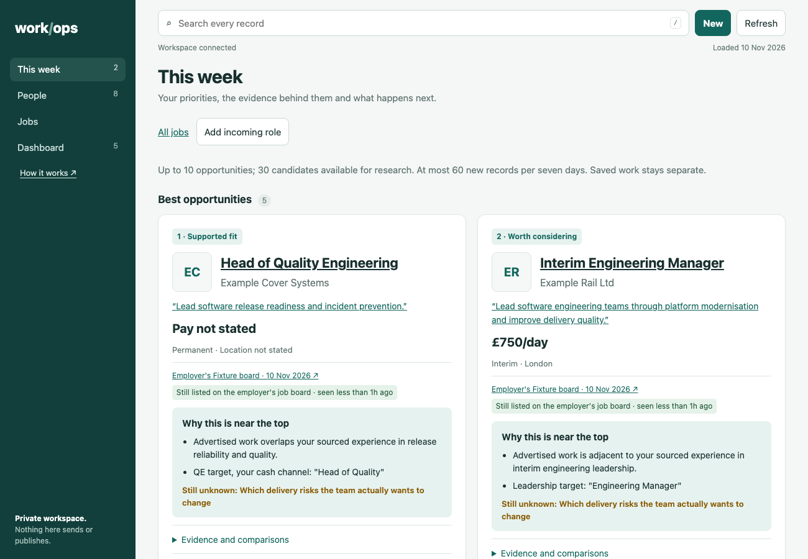

# work/ops

**Find the work worth pursuing, and see why it ranks where it does.**

work/ops is a career workspace for one person. Every day it collects job adverts, tenders, company
news and job-alert email. It ranks each opportunity against a candidate profile and shows its
reasons. Twice a day, a sandboxed model researches the best leads.

I built it for my own job search, and it has run every day since September 2026. This repository is
a snapshot of that system. An example candidate and made-up records replace all personal data.

[How it works](#how-it-works) · [Technology](docs/technology.md) · [Run it locally](#run-it-locally) ·
[User guide](USER-GUIDE.md) · [Agent rules](CLAUDE.md)



*This week, the start page. Each card gives its reasons and the question that is still open.*

## What it does

- **Collects work every day.** Employer job boards, tenders, contract awards, Companies House,
  funding news, Hacker News and job-alert email. Each read leaves a receipt, so a failed read never
  looks like "no results".
- **Shows its reasons.** The workspace scores each opportunity from recorded facts when a page
  loads. It never stores a score, so the reasons always match the evidence.
- **Researches the best leads.** A model gets a short brief about selected jobs. The server reads
  every page the model cites, and a separate worker checks each finding before it records it.
- **Keeps every change.** One record service makes every write and keeps the full history.
- **Leaves the sending to you.** The code cannot send mail. You write and send every message and
  application.

## Every recommendation shows its evidence


*A job's work assessment: the advertised terms, the remit quoted from the advert, the fit and the
research status.*

## How it works

![Employer job boards, tenders and filings, and job-alert email feed collection on the server, which records a receipt for every read. Every write goes through one record service. Ranking on read turns the records into reasons and unknowns on the workspace site, which you open on desktop or iPhone behind Cloudflare Access. Twice a day the research worker sends selected context to a model session in a sandbox with no shell and no database, then validates the answer before recording findings. Coding agents reach the records only through the agent gateway, which allows record-level edits.](docs/images/architecture.svg)

*Every write goes through the record service. The model sees only the context it is given.*

Collection and research run on systemd timers on a small VPS. Cloudflare Tunnel publishes the site,
and Cloudflare Access lets only me in. Every night the server makes an encrypted backup, and
another machine restores it in a drill.

Two boundaries do most of the work:

- **The model never touches the data.** It runs under its own account with no shell, and systemd
  hides the database from it. It must answer in a fixed schema.
- **Coding agents go through a gateway.** They reach live records only through a forced SSH command.
  It allows record-level edits and marks each one as an agent change.

[Technology and architecture](docs/technology.md) shows every component, the limits that the code
enforces and the five system diagrams.

## Run it locally

You need Python 3.12. The browser tests also need Node.js.

```sh
git clone https://github.com/you1anna/eidetic-career-ops.git && cd eidetic-career-ops
python3.12 -m venv .venv && .venv/bin/pip install -r requirements-dev.txt
.venv/bin/python tools/make_fixture.py demo.db
.venv/bin/python workspace/server.py --db demo.db --port 8791
```

Open <http://127.0.0.1:8791>. The fixture holds made-up jobs, companies and people, and the example
candidate in [`config/profile.yml`](config/profile.yml). To run every test suite, use `ops/check.sh`.

## Built with coding agents

I set the direction. Claude Code and Codex write most of the code, under rules that hooks and tests
enforce. From 13 September to 18 November 2026 the private repository took more than 700 commits;
at least 420 of them name an agent co-author.

- [CLAUDE.md](CLAUDE.md) and [AGENTS.md](AGENTS.md) say what an agent can do alone and what needs me.
- [`test_record_layers.py`](workspace/test_record_layers.py) fails when a dependency points the
  wrong way.
- [`deploy.sh`](ops/vps/deploy.sh) tests the exact commit before it changes the live site.

## What's ready

The private system runs every day: collection, job-alert email every 15 minutes, research twice a
day and a nightly backup. This snapshot runs only on your own machine, on made-up records. Its
hosting files use placeholder addresses such as `work.example.com`. The software does not repair or
deploy itself, and its sources do not cover the whole job market.

## Read next

| Guide | Purpose |
| --- | --- |
| [Technology and architecture](docs/technology.md) | See every component, the system diagrams and the design limits. |
| [User guide](USER-GUIDE.md) | Learn the screens and the weekly routine. |
| [Code map](docs/architecture.md) | Find the modules, the record rules and the invariants. |
| [Operations](ops/OPERATIONS.md) | Host, schedule, back up and recover the system. |
| [All guides](docs/README.md) | Find a guide by task. |

## About

Built by Robin Miklinski ([eidetic.engineering](https://eidetic.engineering),
[github.com/you1anna](https://github.com/you1anna)). The workspace is also the prototype for a
[research service for outplacement providers](docs/product.md). See the
[interactive pitch](https://work.eidetic.engineering/career-ops#journey).

All rights reserved. You may read this code and run it locally to evaluate it. No licence to use,
copy, modify or distribute it is granted. See [LICENSE](LICENSE).
