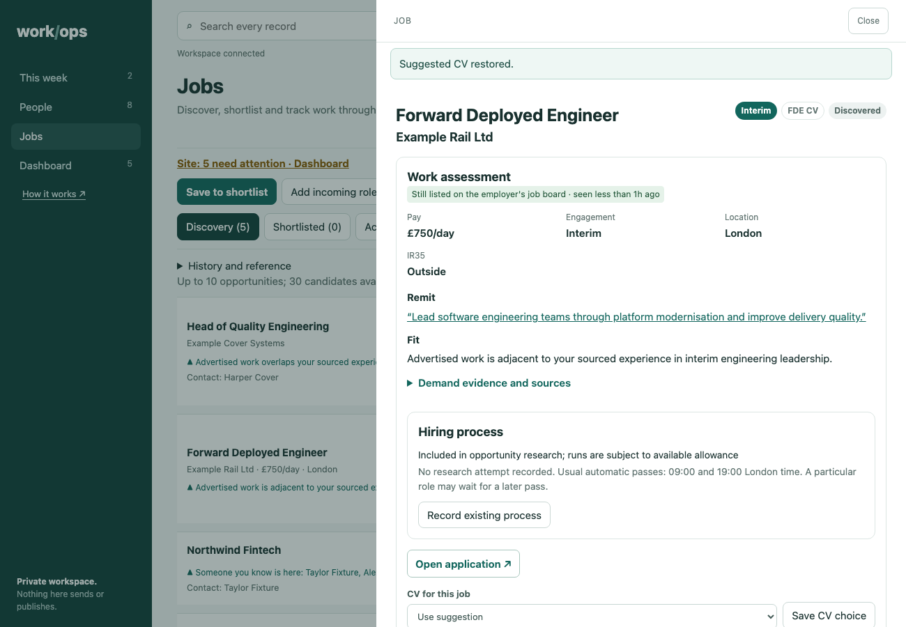

# work/ops

**A working AI application that finds the work worth pursuing, researches it with a sandboxed
model and explains every recommendation.**

work/ops is a single-user career workspace. Every day it collects job adverts, tenders, company
news and job-alert email, keeps them as records with full history, ranks them against a candidate
profile and has a model research the best leads under strict limits. I built it for my own use,
and it has run every day since September 2026. This repository is a snapshot of it, with every
personal fact replaced by an example candidate, shared to show how I build AI applications and
integrations.

[Run it locally](#run-it-locally) · [How it works](#how-it-works) · [Agent rules](CLAUDE.md) ·
[Code map](docs/architecture.md) · [User guide](USER-GUIDE.md)


*This week, the starting page, on made-up records. Each opportunity says why it ranks where it does
and what is still unknown.*

## What it does

- **Collects work every day.** Employer job boards (Greenhouse, Lever, Ashby, SmartRecruiters,
  Rippling), public tenders and contract awards, Companies House, funding news, Hacker News and
  job-alert email. Each source is declared in one registry, and each read leaves a receipt, so a
  failed or partial read never looks like "no results".
- **Ranks it with reasons.** Ranking on read computes every score from recorded facts and
  configuration, never stores it, and shows the reasons and unknowns behind it.
- **Researches the best leads.** Twice a day the research worker gives a model a bounded brief
  about selected opportunities. The answer must match a JSON schema, and the worker validates
  every finding before recording it with its sources.
- **Keeps every change.** One record service makes every write, with revision-checked writes in
  short transactions, declared state transitions and full history. The interface offers only the
  actions the API accepts.
- **Turns failures into tasks.** A failing source, crashed scanner or overdue backup raises a task
  on the dashboard, and the task withdraws itself after a later complete run.
- **Works on desktop and iPhone.** The same journeys are tested in desktop Chromium and iPhone
  WebKit.

## Every recommendation shows its evidence



*A job's work assessment: the terms as advertised, the remit quoted from the advert, how it fits
the candidate's experience and when research will look at it.*

## What it will not do

- **Send anything.** There is no mail transport in the code. The email Worker only receives
  ([`ops/email-intake/src`](ops/email-intake/src)); a person writes and sends every message and
  application.
- **Let the model near the data.** The model session runs under its own account, and systemd
  makes the database directory inaccessible to it
  ([`wo-research-codex@.service`](ops/vps/wo-research-codex@.service)). It runs in a read-only
  sandbox with no shell and must answer in a fixed schema ([`research_codex.py`](tools/research_codex.py)).
- **Let an agent go around the rules.** Coding agents reach live records only through the agent
  gateway, a root-owned forced SSH command that allows record-level reads and edits and marks each
  one as an agent change ([`wo_agent_gateway.py`](ops/vps/wo_agent_gateway.py)). A Claude Code hook
  refuses raw SSH that would bypass it ([`agent_guard.py`](ops/local/agent_guard.py)).
- **Fill a gap with a guess.** Unstated pay, IR35, contact details or relationships stay unknown,
  and the page says so ([`job_rules.py`](tools/job_rules.py)).
- **Read private addresses.** The web reader refuses loopback, private, link-local and
  cloud-metadata addresses, and checks again after every redirect and DNS lookup
  ([`web_read.py`](tools/web_read.py)).
- **Reach the internet from a test.** The root [`conftest.py`](conftest.py) refuses any connection
  beyond loopback.

## How it works

![Employer job boards, tenders and filings, and job-alert email feed collection on the server, which records a receipt for every read. Every write goes through one record service. Ranking on read turns the records into reasons and unknowns on the workspace site, which you open on desktop or iPhone behind Cloudflare Access. Twice a day the research worker sends selected context to a model session in a sandbox with no shell and no database, then validates the answer before recording findings. Coding agents reach the records only through the agent gateway, which allows record-level edits.](docs/images/architecture.svg)

*Every write goes through the record service. The model session sees only the context it is
given, and its answer is checked before anything is recorded.*

Collection runs on a small VPS under systemd timers: public sources daily, and job-alert email
every 15 minutes from a Cloudflare Email Worker. The workspace site is served through a Cloudflare
Tunnel, behind Cloudflare Access. Backups are encrypted nightly with age and restored in a drill on
another machine.

[System map](docs/system-map.md) · [Data pipeline](docs/data-pipeline.md) ·
[Research worker](docs/vps-research.md) · [Source adapters](docs/scanners.md) ·
[Operations](ops/OPERATIONS.md)

## Run it locally

You need Python 3.12, and Node.js for the browser tests.

```sh
git clone https://github.com/you1anna/eidetic-career-ops.git && cd eidetic-career-ops
python3.12 -m venv .venv && .venv/bin/pip install -r requirements-dev.txt
.venv/bin/python tools/make_fixture.py demo.db
.venv/bin/python workspace/server.py --db demo.db --port 8791
```

Open <http://127.0.0.1:8791>. The fixture holds made-up jobs, companies and people, and the example
candidate in [`config/profile.yml`](config/profile.yml). `ops/check.sh` runs every suite and
installs the pinned browser dependencies when they are missing.

## Built with coding agents

I direct the work, and coding agents (Claude Code and Codex) write it under rules that hooks and
tests enforce. From 13 September to 18 November 2026 the private
repository took more than 700 commits; at least 420 of them record an agent co-author. The suite has 1,947
Python tests, contract checks over the whole workspace state and browser journeys on two engines,
all on synthetic records.

| Start with | To see |
| --- | --- |
| [CLAUDE.md](CLAUDE.md), [AGENTS.md](AGENTS.md) | What an agent may do alone, what needs the owner in chat and what becomes a decision on the site |
| [`.claude/commands/`](.claude/commands), [`verify-changes`](ops/skills/verify-changes/SKILL.md) | Agent workflows for decisions, releases and repair, and the verification skill they follow |
| [`test_record_layers.py`](workspace/test_record_layers.py) | Module ownership and dependency direction, enforced as tests |
| [`make_fixture.py`](tools/make_fixture.py) | The synthetic records every test and screenshot uses |
| [`journeys.mjs`](tests/ui/journeys.mjs) | Complete user journeys in desktop Chromium and iPhone WebKit |
| [`deploy.sh`](ops/vps/deploy.sh) | A release that runs every check on the exact commit before it touches the running site |

## Tech stack

- **Python 3.12** with the standard library, PyYAML and pypdf, on **SQLite**; no framework.
- **Vanilla JavaScript**, with no build step.
- **TypeScript** for the Cloudflare Email Worker; **Cloudflare Tunnel and Access** in front of the site.
- **systemd** timers and sandboxing on a small VPS; **age** for encrypted backups.
- **Codex CLI** for scheduled research; **Claude Code** and **Codex** for development.
- **pytest** and **Playwright** for the tests.

## Status

- **Running privately since September 2026:** daily collection, job-alert email every 15 minutes,
  research twice a day and nightly encrypted backups with a restore drill.
- **This snapshot runs locally only**, on synthetic records. The hosting code is included for
  reference with placeholder addresses (`work.example.com`, `203.0.113.10`), so the live-data and
  release commands have nothing to connect to.
- **Not built:** autonomous code repair or deployment. Scheduled model sessions have no write
  tools, and coverage is what the configured sources read, not the whole job market.

## About

Built by Robin Miklinski ([eidetic.engineering](https://eidetic.engineering),
[github.com/you1anna](https://github.com/you1anna)). The product idea it supports, a candidate
research service for outplacement providers, is in [docs/product.md](docs/product.md) and the
[interactive pitch](https://work.eidetic.engineering/career-ops#journey).

Copyright © 2026 Robin Miklinski. All rights reserved: you may read this code and run it locally
to evaluate it, but no licence to use, copy, modify or distribute it is granted. See
[LICENSE](LICENSE).
