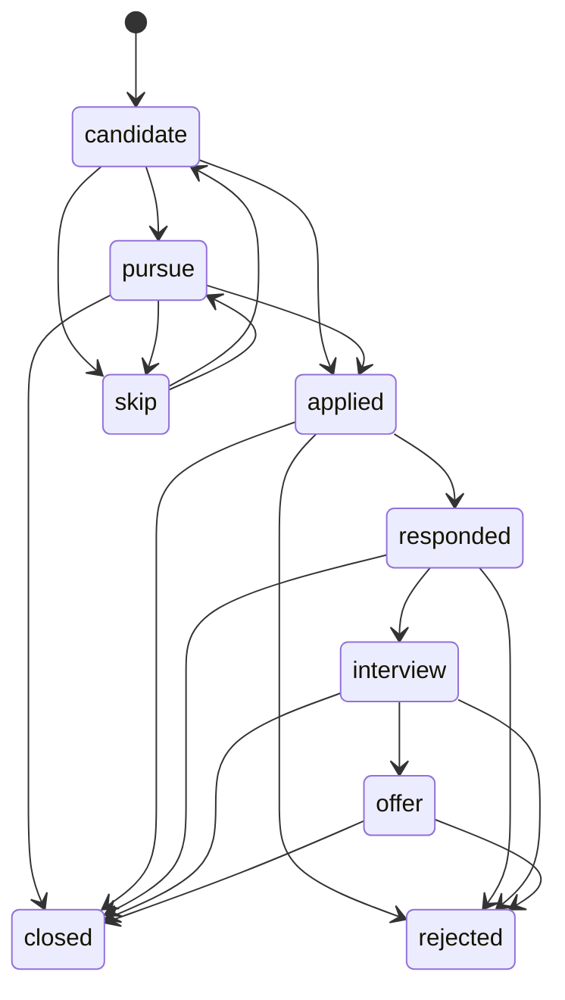
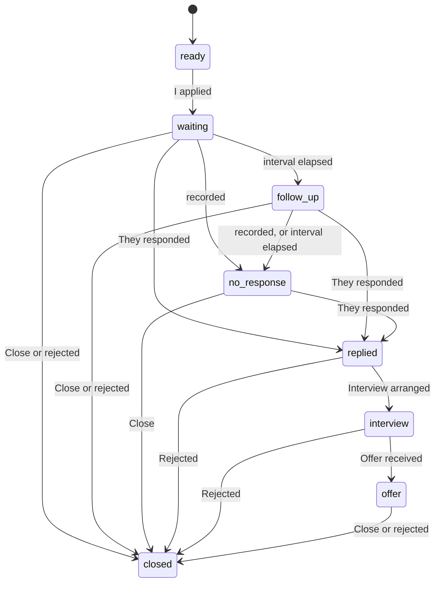
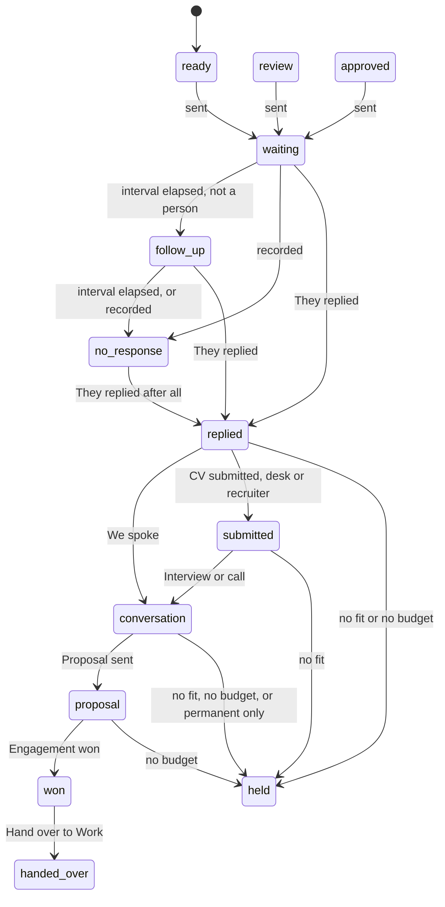
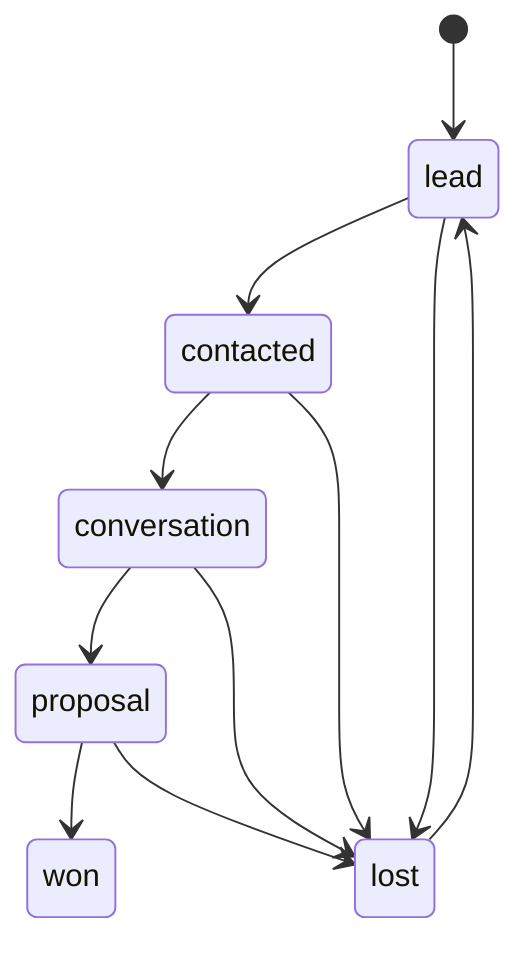
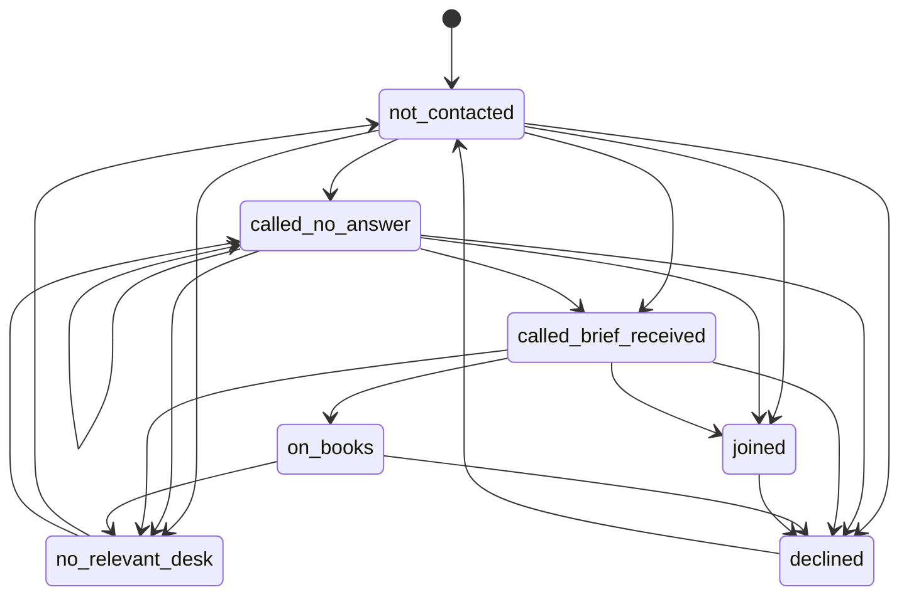
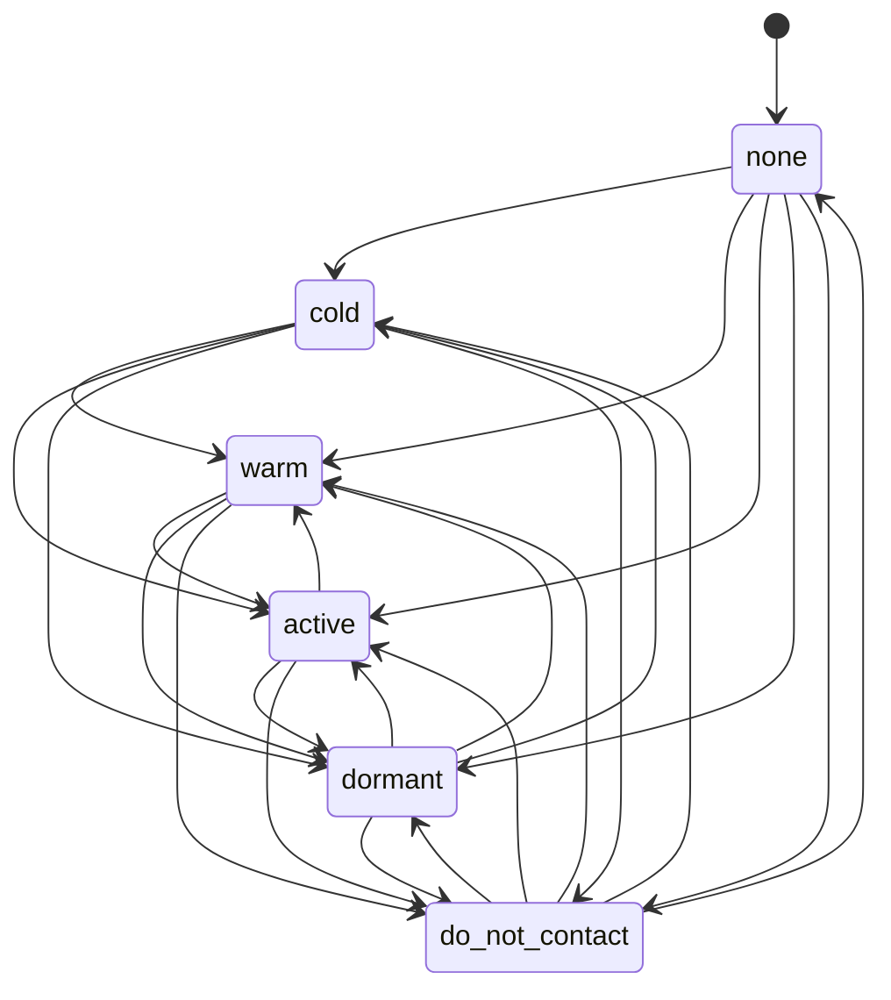
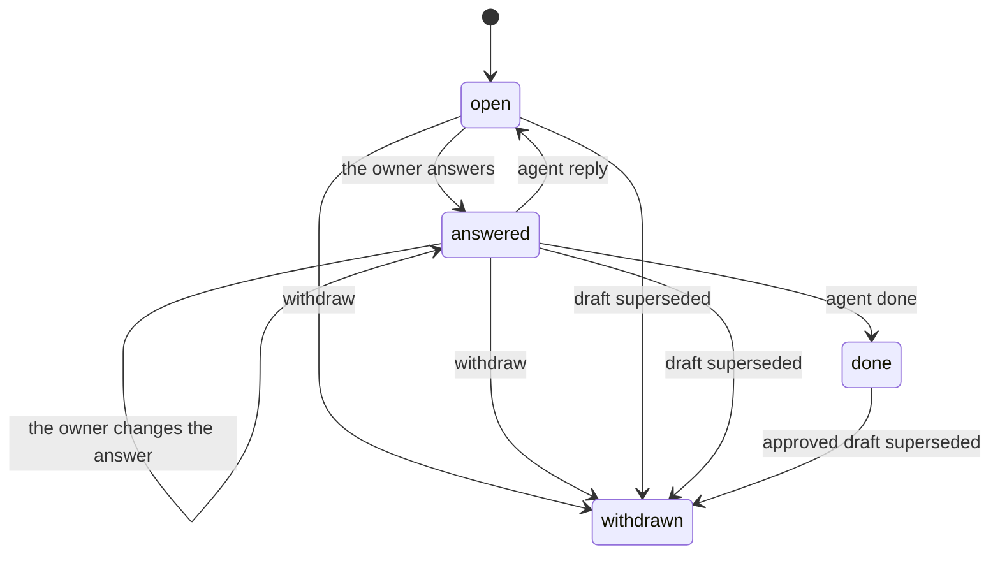
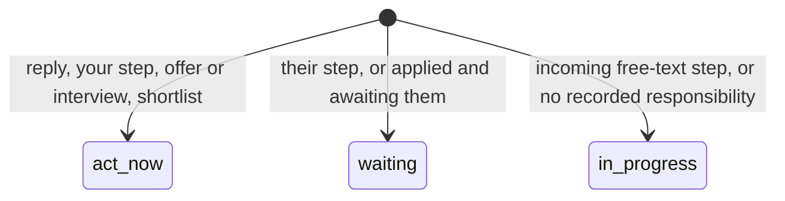

# State machines

[Documentation index](README.md) · [Architecture](architecture.md) · [Agent entry point](../AGENTS.md)

Two modules own the lifecycles an agent may change:

- [`workspace/states.py`](../workspace/states.py) stores job status, opportunity stage, organisation status and person relationship. `records.transition` is the only writer. The CLI (`wo transition`), the site and importers such as an email-lead shortlist all call it.
- [`workspace/machines.py`](../workspace/machines.py) declares derived approach progress, the card actions and sections that follow from it, weekly attention and decision status. The browser copies the person-queue sets in [`workspace/js/machines.js`](../workspace/js/machines.js). A test fails if the two lists drift.

A refused move names the current state, the attempted move and the allowed ones. Example: `Cannot transition job.status from 'candidate' to 'closed'. Allowed: pursue, applied, skip.`

No column was added. Progress is still derived from the job status, recorded outcomes and the contact interval. Existing URLs are unchanged.

## Inventory

Proven means the combination is enforced or produced by a code path in this repository. Suspected means the code does not check it, and this change did not inspect a live database.

| Entity | Where state lives | States and what moves them | Who moves it | Invalid or unreachable | Evidence |
| --- | --- | --- | --- | --- | --- |
| Job | `records.status` | `candidate`, `pursue`, `skip`, `applied`, `responded`, `interview`, `offer`, `rejected`, `closed`. See the diagram below. | The owner on the card or `wo transition`. An email-lead shortlist moves `candidate` to `pursue`. Research insert sets `candidate` only on create. | `rejected` and `closed` have no onward move. `candidate` cannot jump to `closed`. | Proven. `states.TRANSITIONS` and `records.transition`. |
| Application progress | Derived. Not stored. | Job status, a follow-up outcome and the contact interval become `ready`, `waiting`, `follow_up`, `no_response`, `replied`, `interview`, `offer`, `closed`, `skipped`. | The same job transition, plus the owner recording `followed_up` or `no_response`. The interval is applied when the page is built, not by a scheduler write. | A named application accepts only the outcomes on its card. `ready` offers `I applied`, not `Close`. | Proven. `machines.APPLICATION_OFFERS`, `approaches._status`. |
| Outreach progress | Derived from outcomes (`approach_history.STAGE`) and the interval. | `research`, `ready`, `review`, `approved`, `waiting`, `follow_up`, `replied`, `submitted`, `conversation`, `proposal`, `won`, `handed_over`, `held`, `no_response`. | The owner recording an outcome on a named approach. Elapsed time moves a non-person from `waiting` to `follow_up`, then to `no_response`. A person stays `waiting`. | A named approach cannot record an outcome its card does not offer. An outcome with no approach id can still record a later fact, including a conversation with no prior send. | Proven. `machines.OUTREACH_OFFERS` and `record_outcomes.outcome`. The unscoped fact is intentional (`make_fixture` records one). |
| Weekly section | Derived in `work_selection`. | `act_now`, `best`, `needs_checking`, `in_progress`, `waiting`. Attention causes are `reply`, `your_step`, `their_step`, `incoming`, `stage`, `shortlisted`, `submitted`, `unassigned`. | Nobody writes it. Placement rules choose the group; `machines.ATTENTION` chooses the section. | A shortlisted role with no step is Act now. Applied work with their step is Waiting. Needs checking is the next research targets, not a stored status. | Proven. `work_selection._attention`. |
| People queue | Derived in the browser from progress. | `needs_reply`, `next_step`, `waiting`, `act_now`, `priority`. | Nobody writes it. `queueKey` in `machines.js` matches `machines.person_queue_key`. Act now and priority are added from the weekly list and the person's priority. | A terminal progress status produces no key, unless they wrote after the last recorded step (`reply_to_record`). | Proven. `people-context.js` and `test_machines.py`. |
| Opportunity | `records.stage` | `lead` → `contacted` → `conversation` → `proposal` → `won` or `lost`. `lost` can return to `lead`. | The owner via `records.transition`. An outcome does not move the stage. | `won` has no onward move. `lead` cannot become `won` directly. | Proven. `states.TRANSITIONS`. `test_api` records `won` as an outcome and the stage stays `lead`. |
| Organisation | `records.status` on a company or agency | `not_contacted`, `called_no_answer`, `called_brief_received`, `on_books`, `no_relevant_desk`, `declined`, `joined`. | The owner via `records.transition`. | `on_books` cannot return to `not_contacted`. | Proven. `states.TRANSITIONS`. |
| Person relationship | `records.relationship` | `none`, `cold`, `warm`, `active`, `dormant`, `do_not_contact`, with the edges in `states.TRANSITIONS`. | The owner via `records.transition`. Moving to `do_not_contact` clears priority. | Kind, channel, ask and priority are vocabularies, not graphs: any declared value may replace any other. | Proven for relationship. Kind has no transition table (`allowed_from` returns the whole vocabulary). |
| Decision | `decisions.status` | `open` → `answered` → `done` or `withdrawn`. `reply` returns `answered` to `open`. Replacing a draft supersedes `open`, `answered` or an approved `done` to `withdrawn`. | The owner answers. The agent processes, withdraws or supersedes. Ingest withdraws a failure once the source works. | `open` cannot go to `done`. `withdrawn` has no onward move. Claim and block keep `answered` and change execution state only. | Proven. `machines.DECISION_MOVES`. |
| Working state | `records.working_state` and `followups.status` | `needs_review`, `ready`, `in_progress`, `waiting`, `blocked`, `paused`, `done`. | The owner or an agent via `wo followup`. | Any of those values may be set from any other. `done` does not move stage or status. Waiting and blocked require a reason and a dependency. | Proven. `record_mutations.followup`. Left as a set, not a graph. |
| Advert availability | Derived by `evidence_checks.advert_availability` | `open`, `unconfirmed`, `closed`. | A daily listing, a research read, a source lifecycle or a passed deadline. Nothing stores a transition. | `closed` comes only from a gone lifecycle, a closed vacancy check or a passed deadline. A failed read does not close an advert. | Proven. Left derived: it is evidence, not a workflow. |
| Research run | `scan_runs.status` plus the receipt JSON | `running`, then `partial`, `ok`, `failed` or `blocked`, as assigned by the worker. | The research timer and an attended replay. | The receipt writer stores the status string it is given. It does not check a set. | Proven that the writer does not validate. No live row was inspected. Left implicit. |
| Email intake | Spool plus `scan_runs` receipt | Collection pending, processing, quarantine, receipt `running` / `ok` / `partial` / `failed`. | `wo-email` timer. The owner can ask for a quarantine retry. | No single status column covers the spool, the parser quarantine and the receipt. | Proven as separate fields in `email_worker` and `scan_alerts`. Left implicit. |

## What changed

Job, opportunity, organisation and relationship transitions already existed. They now fail with the current state, the refused value and the allowed values. The same function is still the one the site, `wo transition` and the email-lead shortlist call.

Application and outreach cards take their actions from `machines.py`. Weekly attention causes and the active/terminal progress sets are the same declaration. A named approach rejects an outcome the card does not list. Recording a fact with no approach id is unchanged, so a conversation can still be written down without a prior send.

Decision processing asks `decision_move` before it writes. Answering a stale decision still returns the existing reload conflict.

People filters take `needs_reply` and the terminal statuses from `machines.js`, which the test holds equal to the Python tuples.

## What stayed implicit, and why

- **Working state.** Any declared value is a valid task label. Turning that into a graph would reject today's `wo followup` calls.
- **Advert availability.** It is recalculated from evidence. A stored state would drift from the listing.
- **Research receipts and email intake.** Several fields move together (receipt, spool, quarantine, source health). A new status column would be a migration with no UX change.
- **Unscoped outcomes.** the owner can record what happened even when the card never offered that step. The guard applies when the caller names the approach.

## Diagrams

### Job status

### Application progress

Derived from the job status. `applied` becomes `waiting`, then `follow_up` once the contact interval has passed, or `no_response` when that outcome is recorded or the follow-up interval has passed. People are not applications. `responded` is shown as `replied`.

A skipped role is the job status `skip`, not a progress-card action. It is shown as progress `skipped`.

### Outreach progress

`ready`, `review` and `approved` all offer the sent outcome. Elapsed time never moves a person out of `waiting`. `no_fit`, `no_budget` and `permanent_only` become `held`. An opportunity drops handover and opens in Work when it is won.

`research` and `held` have no offer list. A saved approach becomes `ready` when the recommendation is usable; that step is not an outcome.

### Opportunity stage

### Organisation status

### Person relationship

### Decision

### Weekly attention

Best opportunities and Needs checking are placement groups, not progress statuses. Best is the discovery set still worth a look. Needs checking is the next qualification targets.
