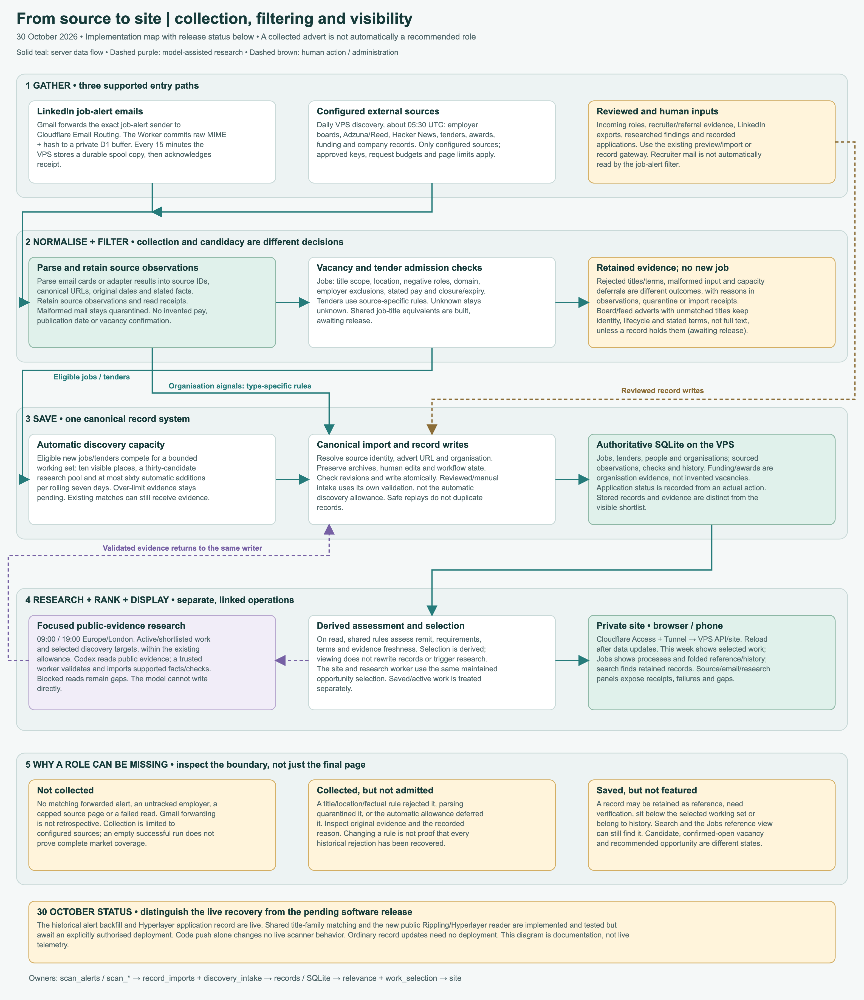
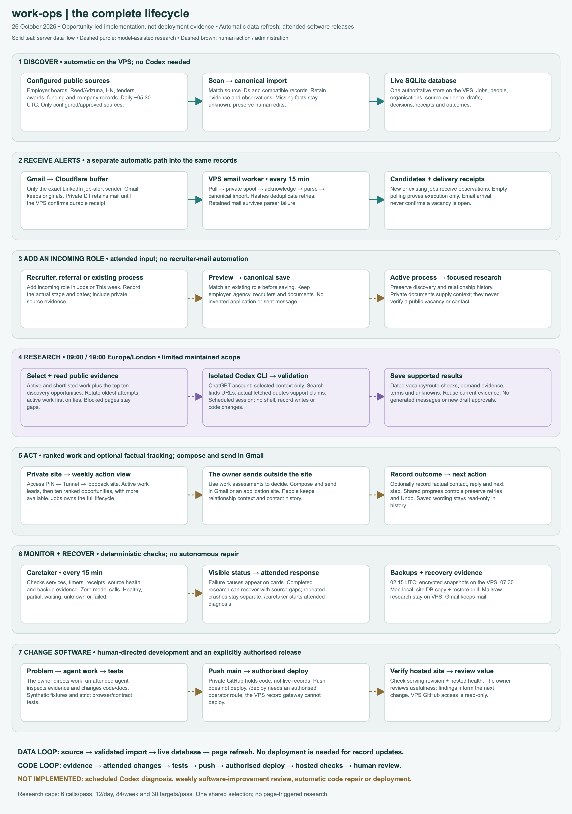
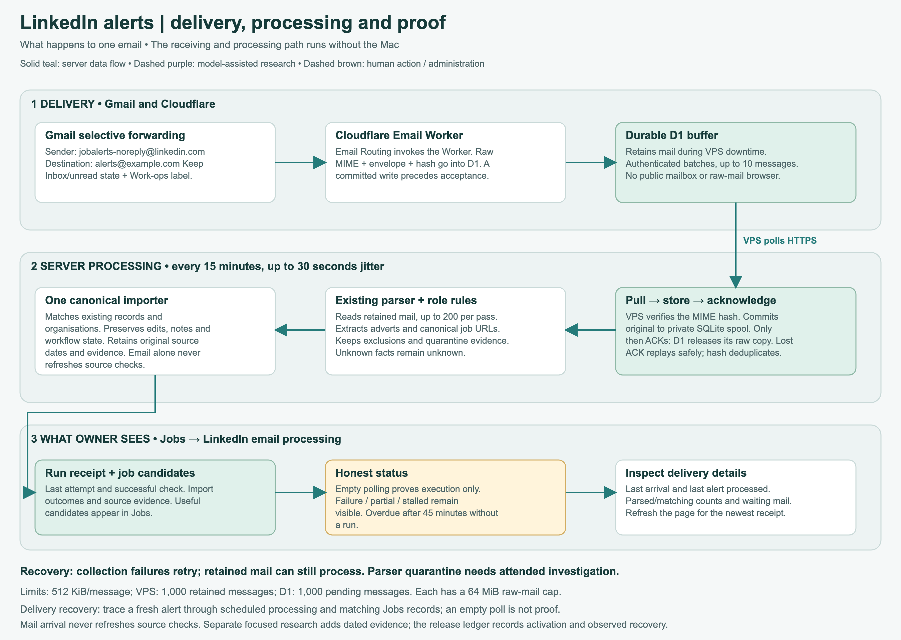
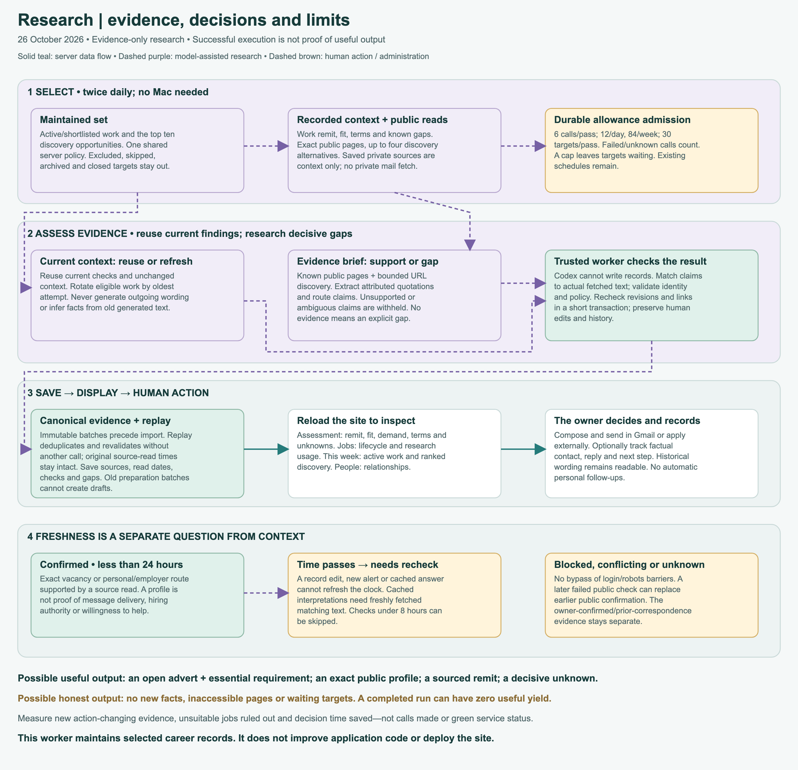
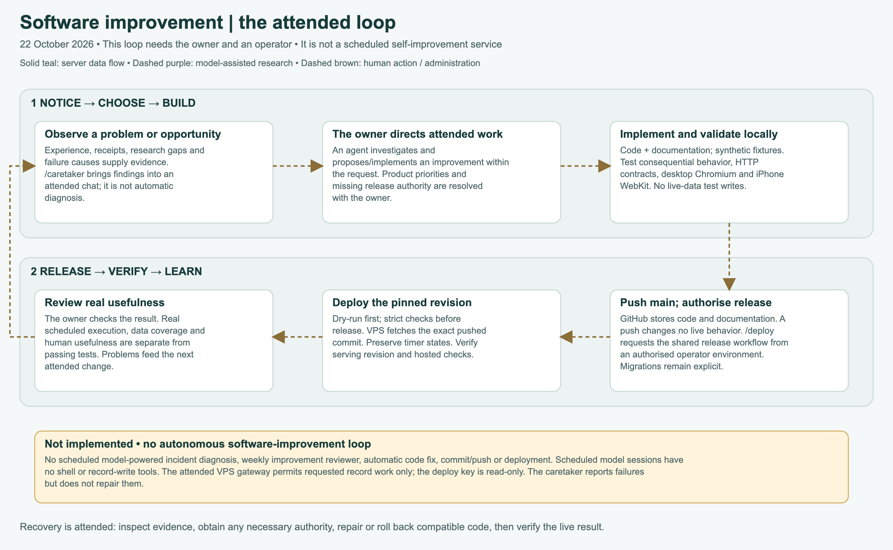

# How work-ops works

[Documentation index](README.md) · [Repository home](../README.md)

**Start here for the whole system.** The VPS collects candidates and serves the private site.
A separate focused research pass checks public evidence and may add supported context, route
checks or decisive unknowns. It can also finish with unresolved gaps and no new facts.
You compose and send in Gmail or the application site; factual tracking on the site is optional.

**Open [How it works on the private site](https://work.example.com/system-map)**, also linked
from the workspace navigation. It provides responsive process cards, expandable explanations,
full-size SVGs and PNG downloads. Sign in through the same Access boundary as the workspace.

The overview, email and research diagrams describe the **26 October opportunity-led implementation**: ranked work,
evidence assessments, incoming hiring processes, optional relationship tracking, monitoring,
recovery and attended releases. This local revision is not deployment evidence.
They are explanatory documentation, not live telemetry. The
activation ledger owns release status and verification.
A completed run may add no useful facts. Automatic data refresh is implemented; autonomous
software diagnosis, improvement and deployment are not.

## From source to site

[PNG — full resolution](data-to-site.png) · [Editable SVG](data-to-site.svg)



This **30 October** diagram distinguishes collection, admission and visibility. Email and external
adapters retain observations; automatic vacancies/tenders pass eligibility and capacity checks.
Reviewed input and validated research use the existing record writers. Read-time selection decides
what appears prominently; a saved record can remain searchable reference. The diagram also shows
where missing, rejected, quarantined and deferred inputs can be investigated.

The backfill and application records are live. The broader title matching and Rippling reader are
implemented but await deployment, as labelled in the figure. This new download is delivered through
the repository; the hosted guide currently contains the original four diagrams. No site deployment
is needed to open or download the linked PNG/SVG here.

## Full system

[PNG — full resolution](system-map.png) · [Editable SVG](system-map.svg)



The live database is on the VPS. The diagrams below show the established LinkedIn path;
Jack and Jill uses that same path once activated (current evidence).
Gmail currently forwards only LinkedIn job-alert mail to
`alerts@example.com`. Cloudflare retains it until the VPS has durably received it.
Both the email worker and daily source scanners import through the existing canonical service.
The browser and the approved agent gateway use that same record system, preserving your edits.

**Add incoming role**, available in Jobs and This week, records recruiter
approaches, referrals and existing interviews. Preview resolves an existing job before saving the
actual stage, dates and private source evidence. It does not invent an application or sent message.
Active processes enter focused research; private documents
remain context, never proof of a public vacancy or contact check.
[Incoming-role walkthrough](../USER-GUIDE.md#add-a-recruiter-role-or-an-existing-interview).

## Email delivery and processing

[PNG — full resolution](email-processing.png) · [Editable SVG](email-processing.svg)



**Look at [Dashboard](https://work.example.com/#dashboard) → Job alert email processing.** The headline
shows the latest outcome and attempt/success times. **Email delivery details** shows arrival,
last actual alert processed by each configured source, counts and unresolved mail. Refresh for the newest receipt;
the displayed age warning updates while the page stays open. Originals stay in Gmail under
**Work-ops/LinkedIn alerts**, including older archived mail. New alerts stay visible and unread
until you read them. The filter does not forward old mail retrospectively.

A successful empty poll proves that the processor ran, not that LinkedIn delivery works.
The delivery incident was resolved on **20 October** after a fresh alert, its scheduled import and
five matching Jobs records were reconciled. The
email ledger
records that chain; it does not prove complete LinkedIn coverage. Use the live panel for later runs.
No independent push-alert service exists.

## Research, contacts and 24-hour freshness

[PNG — full resolution](research-and-freshness.png) · [Editable SVG](research-and-freshness.svg)



An email produces a candidate. Routine research uses the same opportunity selection as the site:
active and shortlisted work plus the top ten discovery opportunities research can check. Adzuna and
Reed adverts are left out until shortlisted: their daily listing already decides availability and
their pages refuse reads. Eligible targets rotate by
oldest attempt, with active work first on ties. Research checks public vacancy/remit evidence and
relevant contact routes, saving supported context, fit, terms and decisive unknowns through the
canonical importer. Existing evidence is reused when current; generated wording is never evidence.
The model cannot write records directly, and page visits never trigger research.
The **Work assessment** brings the evidence together. An old advert can still be open: it looks
open while its source listed it, or research confirmed it, within 48 hours. A failed read is not
evidence either way.
No outgoing messages or draft approvals are generated. Saved wording remains in read-only history.

The [VPS research worker](vps-research.md) runs without the Mac. The desktop heartbeat is paused
and retained for recovery; it does not run in parallel. The server worker reports coverage,
blocked sources, waiting jobs and Codex usage in Jobs.
A colleague's hiring post, InMail or recruiter conversation is outside the exact job-alert sender
filter and needs separate research. Nothing here guarantees complete LinkedIn coverage.

## Your weekly action view

**This week** shows actionable work in progress and ranked discovery. Suitability and evidence date
lead; engagement preference breaks ties, so a stronger permanent role can outrank a weaker contract.
Best opportunities initially shows three cards, expanding to ten. Unknown terms stay explicit. **Jobs** owns the complete lifecycle and shared progress
controls; old Pipeline links redirect there. **People** owns relationships and optional factual
contact/reply/next-step tracking. Personal outreach, quotas and automatic follow-ups leave This week.
People can prepare temporary message wording; sending occurs in Gmail or the selected external channel. [Weekly routine](../USER-GUIDE.md#your-weekly-routine).

## Software improvement and release

[PNG — full resolution](software-lifecycle.png) · [Editable SVG](software-lifecycle.svg)



Monitoring supplies evidence, not automatic repairs. `/caretaker` brings current findings into an
attended coding chat; `/deploy` starts the shared release workflow when explicitly requested from
an authorized operator environment. An attended agent implements the owner's request,
validates against synthetic fixtures and pushes main. An explicitly authorised deployment fetches
the pinned revision, verifies the running version and runs hosted checks. The owner reviews actual
usefulness. The caretaker makes zero model calls; scheduled model-powered diagnosis, weekly
improvement review, automatic code fixes and automatic deployment are not implemented. The VPS
GitHub key is read-only. Record imports need no deployment; they appear when the page is reloaded.

## What runs where

| Activity | Where and when | Needs your Mac? | Where you see the result |
| --- | --- | --- | --- |
| Receive forwarded job alerts | Cloudflare, when Gmail forwards new matching mail | No | Arrival in the next email receipt |
| Collect, parse and import email | VPS, every 15 minutes, up to 30 seconds jitter | No | Dashboard → Job alert email processing; matching Jobs |
| Other source discovery | VPS, about 05:30 UTC daily | No | Dashboard → Needs attention (failures); candidate records in Jobs |
| Opportunity evidence research | VPS Codex CLI: 09:00 and 19:00 Europe/London | **No**; old desktop automation paused | Dashboard → Job and contact research; work assessments and dated checks |
| Site caretaker | VPS deterministic checks every 15 minutes; zero model calls | **No**; Mac off-host evidence is checked separately | Dashboard → Site caretaker |
| Serve the private site | VPS through Cloudflare Access/Tunnel | No | Browser or phone |
| Encrypted database and mail/state snapshots | VPS, 02:15 UTC nightly | No | Backup receipt; operator diagnostics |
| Off-host site-database copy and restore drill | Mac, 07:30 local time | **Yes** | Backup run receipt; operator diagnostics |
| Code release | Mac invokes an explicitly authorized deployment; VPS fetches the chosen GitHub commit | Operator access required | Serving revision and hosted checks |

UTC server schedules do not move with British daylight saving. The research schedule follows
Europe/London; the Mac backup follows the installing Mac's local clock. A configured schedule is
not proof that any particular run completed.

## Recovery and access boundaries

Cloudflare D1 keeps unacknowledged mail during a VPS outage. After the VPS commits its own copy,
an acknowledgment releases the D1 raw copy. Replays deduplicate by hash. Malformed alerts remain
available for investigation; collection/import failures remain visible and retry where appropriate.
The stores are bounded, with no silent eviction of pending mail.

The nightly archives in `/srv/offsite/work-ops` are **on the same VPS**, despite the directory name.
The Mac pulls only the **site database** archive and tests its restore. Mail spool/state archives
currently stay on the VPS; Gmail originals provide independent mail-recovery evidence. These are
snapshots, not continuous replication or a zero-loss guarantee. See the
[email recovery procedure](linkedin-alerts.md#backup-and-restore) before any restore.

The site is behind Access and an outbound Tunnel; its application listens only on VPS loopback.
Agents use the approved SSH command gateway, never a mounted/live database copy. The restricted
attended VPS route permits requested record reads/edits only, with no server shell, file reads or
deployment. The scheduled model session is separately restricted and has no record-write tools. Service keys are
systemd-encrypted and scoped to their jobs; the web process cannot read them. The live SQLite file
itself is not application-encrypted. Code and documents live in the private repository; raw mail,
live exports and personal research stay outside Git. A push does not deploy code.

A recent completed research pass (`ok`, or `partial` with no stop reason) can clear its execution
incident while unverified sources stay gaps. Other partial checks, usage waits, pauses and running
receipts do not establish recovery. Three crashes in 24 hours raise a separate service incident,
with a short failure cause. The page marks caretaker status overdue after 45 minutes; the existing
job-triggered watch raises a caretaker failure after two hours. Both depend on the VPS.
[Failure causes and recovery](vps-caretaker.md#when-a-job-fails).

The private local message/CV library is a separate attended reference store, not a hosted service
or part of the site backup. [Reference-data ownership](reference-data.md) explains lookup and recovery.

## One place for each kind of detail

| You need | Read |
| --- | --- |
| What to do on the site and how to recover as a user | [User guide](../USER-GUIDE.md) |
| This visual explanation and downloadable diagrams | **This page** |
| Email transport, acknowledgment, failures and spool recovery | [LinkedIn email runbook](linkedin-alerts.md) |
| Server research, model access, Codex allowance limits and coverage | [VPS research runbook](vps-research.md) |
| Ingestion contracts, verification fields and research imports | [Data pipeline](data-pipeline.md) |
| Code boundaries and record invariants | [Architecture](architecture.md) |
| Owning config files, not copied settings | [Configuration](configuration.md) |
| VPS deployment, service operations and recovery | [Operations](../ops/OPERATIONS.md) |
| Local development and off-host database backups | [Local setup](../ops/LOCAL.md) |
| Current release, incident status and dated evidence | Plan index |

The old direct-POST pilot and Mac **mail-collection** bridge are historical designs and do not
operate alongside the current pipeline. Their test material remains labelled as historical.
The separate desktop research task is paused for recovery; it no longer schedules research. The
Connector project is closed and is not a live component.

## Regenerate the diagrams

From the repository root, run `node tools/render_system_map.mjs` after editing its labels and
connections to match verified facts. It creates all five PNGs and editable SVGs, using the pinned
browser tooling in `tests/ui` ([setup](../ops/LOCAL.md)). Chromium sandboxing stays enabled.
On the restricted VPS, use the approved launch configuration through the normal command permission
layer ([VPS setup](../ops/LOCAL.md#restricted-vps-codex-checkout)):

```sh
WO_DIAGRAM_CHROMIUM_OPTIONS=/home/codex/.config/website-ops/chromium-launch-options.cjs node tools/render_system_map.mjs
```

The renderer checks text stays inside each box;
inspect the rendered images for crossed labels/arrows before committing. Diagrams contain no raw
mail, credentials, personal records or production interface captures.

The hosted reading surface is `docs/system-map.html` with `docs/system-map.css`; the server serves
only those and the eight named diagram assets through explicit routes. Keep the hosted explanations
and generator in step with the runbooks. No other repository documentation is exposed by this route.
