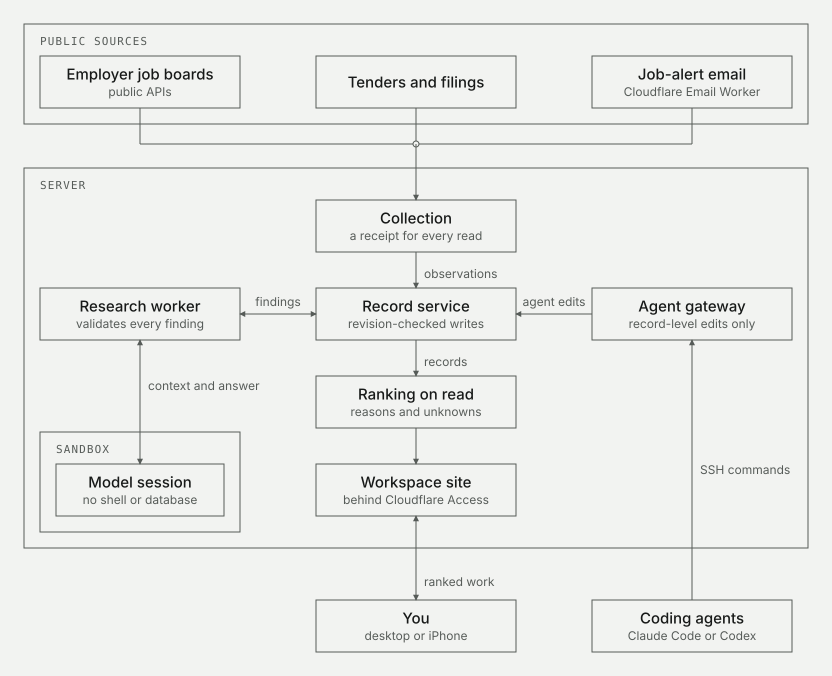
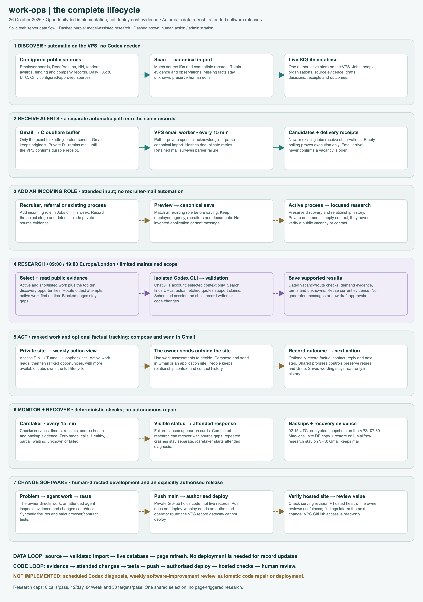
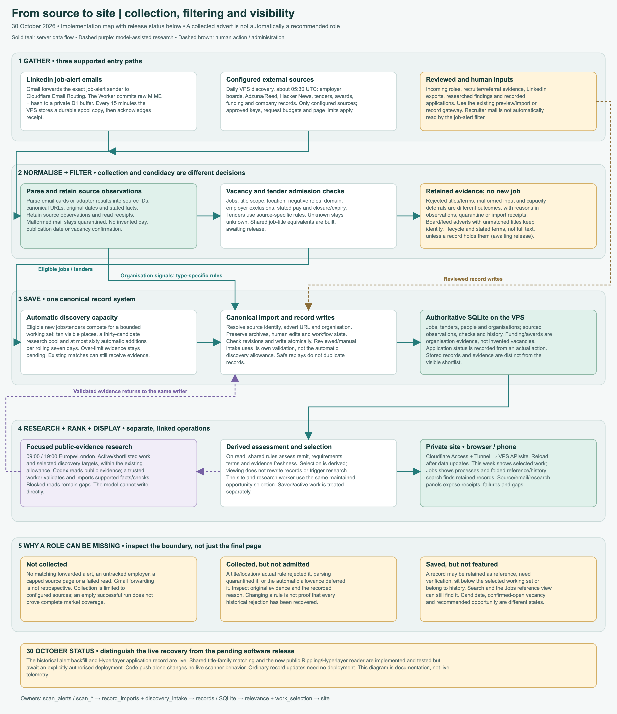
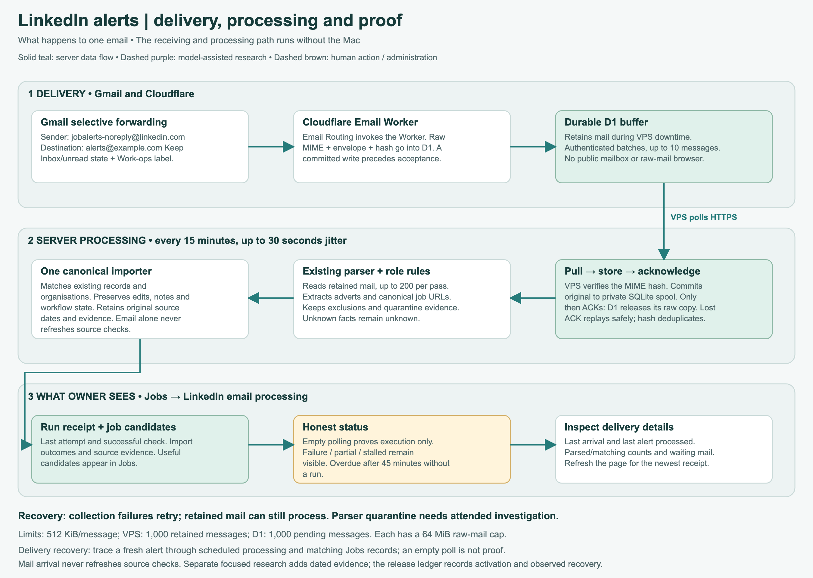
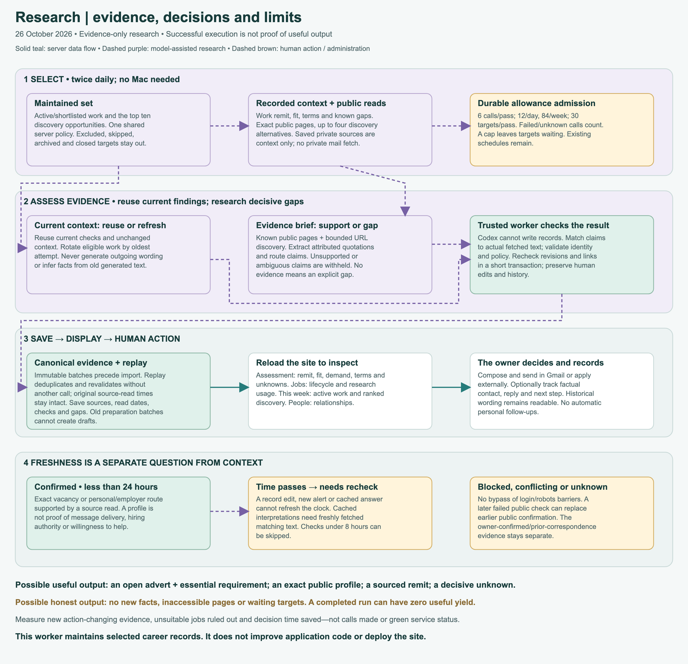
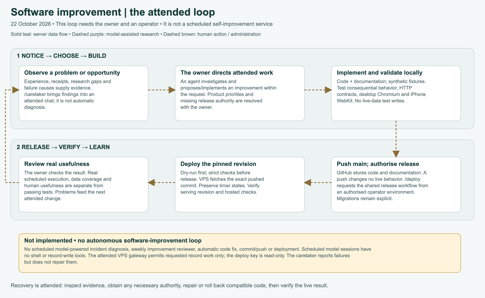

# Technology and architecture

[Overview](../README.md) · [All guides](README.md) · [Code map](architecture.md) ·
[Operations](../ops/OPERATIONS.md)

work/ops is one Python application on one small server. Scheduled workers collect and research
opportunities, a record service stores them in SQLite, and a browser interface shows them. Every
write goes through the record service, so the screens, the workers and the command line share one
set of records and one history.

This page describes the design. The [code map](architecture.md) has the module rules, and
[operations](../ops/OPERATIONS.md) has the hosting details.

## System overview

Public sources feed collection on the server. The research loop is on the left, and the route for
coding agents is on the right. Nothing reaches the records except through the record service.

## Components

| Component | What it does | Code |
| --- | --- | --- |
| Source adapters | Read employer boards (Greenhouse, Lever, Ashby, SmartRecruiters, Rippling), the Adzuna and Reed feeds, tenders, contract awards, Companies House, Hacker News and funding news. Each read leaves a receipt. | [`ingest.py`](../tools/ingest.py), [`scan_boards.py`](../tools/scan_boards.py), [`channels.yml`](../config/channels.yml) |
| Email intake | A Cloudflare Email Worker holds job-alert email in D1 until the server confirms receipt. The server reads it every 15 minutes. | [`email-intake/`](../ops/email-intake), [`email_worker.py`](../tools/email_worker.py) |
| Record service | Makes every write. It checks a revision number inside a short transaction and keeps the full history. | [`records.py`](../workspace/records.py), [`states.py`](../workspace/states.py), [`migrations/`](../workspace/migrations) |
| Ranking | Scores each opportunity from recorded facts when a page loads, with its reasons and unknowns. | [`relevance.py`](../workspace/relevance.py), [`work_selection.py`](../workspace/work_selection.py) |
| Research worker | Twice a day, sends a short brief to a sandboxed Codex CLI session. It checks the answer before it records anything. | [`research_worker.py`](../tools/research_worker.py), [`research_codex.py`](../tools/research_codex.py) |
| Workspace site | Shows This week, Jobs, People and Dashboard on desktop and iPhone. It offers only the actions that the API accepts. | [`server.py`](../workspace/server.py), [`js/`](../workspace/js) |
| Decisions and failure tasks | Ask the owner questions with fixed answers. A failed source raises a task, and the task closes itself after the next complete run. | [`states.py`](../workspace/states.py), [`failure_tasks.py`](../tools/failure_tasks.py) |
| Caretaker | Checks services, timers, receipts and backups every 15 minutes, without a model. | [`caretaker.py`](../tools/caretaker.py) |
| Agent gateway | Gives coding agents record-level access through a forced SSH command. A Claude Code hook blocks other routes. | [`wo_agent_gateway.py`](../ops/vps/wo_agent_gateway.py), [`agent_guard.py`](../ops/local/agent_guard.py) |
| Hosting | Runs a loopback-only server behind Cloudflare Tunnel and Access, with sandboxed systemd units and an nftables guard. | [`ops/vps/`](../ops/vps), [`work-ops-loopback.nft`](../ops/vps/work-ops-loopback.nft) |
| Backups | Makes an encrypted backup every night. Another machine restores it in a drill. | [`wo-backup.sh`](../ops/vps/wo-backup.sh), [`restore-drill.sh`](../ops/restore-drill.sh) |
| Release | Tests the exact commit on made-up data before it changes the live site. | [`deploy.sh`](../ops/vps/deploy.sh), [release workflow](deploy.md) |

## What the code rules out

Each limit below is enforced in code or configuration, not only described.

- **Sending.** The code has no mail transport. The email Worker only receives
  ([`ops/email-intake/src`](../ops/email-intake/src)).
- **Model access to the data.** The model session runs under its own account, and systemd hides the
  database directory from it ([`wo-research-codex@.service`](../ops/vps/wo-research-codex@.service)).
  It has no shell and must answer in a fixed schema ([`research_codex.py`](../tools/research_codex.py)).
- **Agent shortcuts.** Coding agents reach live records only through a root-owned forced SSH command
  ([`wo_agent_gateway.py`](../ops/vps/wo_agent_gateway.py)). A Claude Code hook refuses raw SSH that
  would go around it ([`agent_guard.py`](../ops/local/agent_guard.py)).
- **Guesses.** Unstated pay, IR35 status, contact details and relationships stay unknown
  ([`job_rules.py`](../tools/job_rules.py)).
- **Private addresses.** The web reader refuses loopback, private and cloud-metadata addresses, and
  checks again after every redirect and DNS lookup ([`web_read.py`](../tools/web_read.py)).
- **Network in tests.** The root [`conftest.py`](../conftest.py) refuses any connection beyond
  loopback.

## System diagrams

Five diagrams, generated from source, show the whole system. Select one to open it at full size.
[System diagrams](system-map.md) has the notes for each and the command that regenerates them.

### The complete lifecycle

Discovery, job-alert email, incoming roles, research, action, monitoring and software change, each
in its own lane. Solid lines are automatic server steps. Dashed lines are model research or human
steps.

### From source to site

How an advert becomes a record: collection, eligibility filters, kept exclusions, storage, research
and selection for the site.

### Job-alert email

Gmail forwards only job-alert mail. Cloudflare keeps each message until the server confirms receipt.
The server then parses and imports it.

### Research and freshness

Twice-daily research, the approach brief and source checks that expire after 24 hours.

### Software change and release

How a change moves from evidence through tests to an authorised release and review by the owner.

### Record states

Eight [state diagrams](state-machines.md), drawn in Mermaid, show how each kind of record can
change: jobs, applications, outreach, opportunities, organisations, people, decisions and weekly
attention.

## Technology

| Layer | Choice |
| --- | --- |
| Application | Python 3.12 standard library, PyYAML and pypdf, with no web framework |
| Storage | SQLite with numbered migrations |
| Interface | Vanilla JavaScript, with no build step |
| Email | A Cloudflare Email Worker in TypeScript, with D1 as its buffer |
| Hosting | systemd timers, socket activation and sandboxing; Cloudflare Tunnel and Access; nftables |
| Backups | age encryption and a restore drill on another machine |
| Research | Codex CLI |
| Tests | pytest and Playwright, in desktop Chromium and iPhone WebKit |
| Development | Claude Code and Codex |

## Design trade-offs

- **One server and one SQLite file.** One writer and short transactions keep the data consistent for
  one user. More users would need a different storage and access design.
- **Ranking on read.** Scores always match the current evidence, and no stored score goes stale.
  The cost is computation on each page load.
- **A model with narrow access.** The model sees only selected context and cannot change records.
  Research covers less ground, but a confirmation needs a quote from a page that the server read.
- **People send.** The workspace prepares and records, but it never sends. Every outside contact
  stays a human decision.
