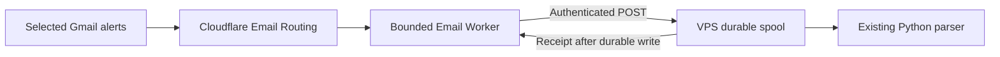

# Email Worker: production buffer and historical pilot

The deployed configuration is [`wrangler.vps.jsonc`](wrangler.vps.jsonc), with
[`src/buffered.ts`](src/buffered.ts) and D1 [migrations](migrations/). Email Routing invokes the
Worker for `alerts@example.com`. It commits raw mail to D1; the VPS pulls authenticated
`/v1/messages` batches and calls `/v1/ack` only after durable local storage. ACK releases raw bytes
while retaining deduplication identity. No inbound VPS email endpoint is required.

The [production runbook](../../docs/linkedin-alerts.md) owns credentials, bounds, schedules,
failures and restore procedures. The [system diagrams](../../docs/system-map.md) explain the full
flow. The activation ledger records observed delivery;
source code and passing local tests alone are not live-delivery proof.

The 17 October security fixes are deployed as
Worker version `8b6fb257-825a-47c3-8a6d-33ecc0ee942d` (tag `9acbfe2`), followed by VPS `9acbfe2`.
They restrict original MIME From admission to LinkedIn job alerts and Google's forwarding
confirmation sender, relying on Cloudflare's upstream authentication rather than arbitrary mail
headers. They also add authenticated `GET /v1/messages?after=<sequence>` pagination; `pending`
always counts all unacknowledged mail, including messages before the cursor. ACK accepts 1–10
unique receipt identities in at most 2,048 UTF-8 bytes and reports the number of stored identities
matched (including already acknowledged replay). Unknown identities do not count as acknowledged.
Release the buffer before the VPS collector; no D1 migration or new secret is required. Real
forwarded-mail acceptance remains a separate release check.

`npm test` includes the buffered Worker tests and `npm run typecheck` checks both implementations.
The `integration-check` and default `dry-run` scripts below exercise the historical direct-POST
pilot; they do not deploy or validate the production buffer. Use the explicit production Wrangler
configuration for production bundle checks; uploading still needs release authorization:

```sh
npm run typecheck
npm test
npx wrangler deploy --config wrangler.vps.jsonc --dry-run
```

## Historical direct-POST pilot — not deployed

In this older design, Cloudflare accepts mail for `alerts@example.com` and posts it to the existing
UpCloud VPS. The VPS owns durable retention and ingestion. This Worker has no database,
mailbox, queue, polling job, mail-reading endpoint, or outgoing-email binding.



This is a local implementation, not an activated route. `wrangler.jsonc` contains a
reserved placeholder destination, disables `workers.dev` and preview URLs, and declares
no email addresses, HTTP routes, cron triggers or storage resources. Deploying this
configuration cannot silently switch an existing email route.

## VPS protocol

The Worker sends exactly one `POST` to the configured `INTAKE_URL`. Its path must be
`/v1/email`, without credentials, query parameters or fragments. HTTPS is required.
An explicit `ALLOW_LOOPBACK_HTTP=true` also permits HTTP to `127.0.0.1`, `localhost`
or `[::1]` for local tests; it never permits HTTP to another host.

The body is the unchanged raw MIME bytes, at most 512 KiB. The Worker checks both the
reported size and the actual single-use stream; oversized streams are cancelled.
Headers are:

- `Content-Type: message/rfc822`
- `Authorization: Bearer <INTAKE_TOKEN>`
- `CF-Access-Client-Id: <CF_ACCESS_CLIENT_ID>`
- `CF-Access-Client-Secret: <CF_ACCESS_CLIENT_SECRET>`
- `X-Alert-Envelope-From`: envelope sender, maximum 320 characters, no CR/LF/NUL
- `X-Alert-Envelope-To`: exactly `alerts@example.com`
- `X-Alert-Received-At`: this attempt's UTC ISO receipt time

All three credentials are required, including in the local harness (synthetic test
values of at least 32 characters are sufficient there for the VPS bearer token). Store real values as Worker secrets; never put them in
Wrangler variables, commands, repository files or logs. The Access policy must admit
this service token only to the intake service; the receiver checks its independent
bearer token as well.

A successful response is HTTP 200 or 201 with JSON content type and, within 4 KiB:

```json
{
  "receipt_id": "<lowercase SHA-256 of the exact raw body>",
  "sequence": 1,
  "received_at": "2026-10-07T10:00:00.000Z",
  "duplicate": false
}
```

The sequence must be a positive safe integer and the date a valid UTC timestamp
(`Z` or `+00:00`, optional fractional seconds). A duplicate keeps the receiver's first
sequence/date. The Worker awaits and validates this acknowledgment before succeeding.
It forbids redirects and cancels a delivery after 10 seconds, including reading the
response body. No HTTP retry is attempted automatically. A timeout after the VPS has
committed may mean the delivery succeeded; replaying the same bytes is the safe way
to resolve that uncertainty through the receiver's idempotent receipt.

MIME From filtering, authenticity checks and parsing belong downstream. The bridge
preserves the source without interpreting arbitrary `Authentication-Results` headers
as trusted. Gmail forwarding verification messages can pass through. No code here
sends a message, auto-replies, follows email links, or interprets email content as
instructions.

## Failure behaviour

Wrong recipients, invalid envelope headers, empty messages and oversized mail call
Cloudflare's `setReject`, which is a **permanent SMTP rejection**. There is no durable
copy at the VPS for those messages.

Configuration errors, stream failures, timeout, network failures, non-200/201 responses
and invalid acknowledgments throw fixed safe errors. They do not report successful
receipt. **The resulting real SMTP response and Cloudflare retry behaviour have not
been verified.** Do not promise automatic retry or no-loss delivery. Keep Gmail's
originals until actual forwarding and failure/replay drills have passed.

Structured logs contain only fixed outcomes such as `retained`, `duplicate`,
`delivery_failed` and `acknowledgment_failed`. Invocation logs and tracing are disabled;
the code logs no sender/recipient, subject, content, URL, receipt hash or credentials.
These logs provide diagnostic evidence, not an automatic notification service.

## Local verification

From this directory:

```sh
npm ci
npm run check
```

`check` verifies generated binding types, TypeScript, tests running in the actual local
Workers runtime with mocked VPS responses, a real local Worker-to-Python round trip,
and a local Wrangler bundle dry-run. It requires loopback sockets. It neither logs into Cloudflare nor deploys or reads remote
storage. Tests use synthetic mail and credentials only. Dependencies are locked. The `sharp`,
`undici` and `zod` overrides and Vitest 4.1.12 minimum address inherited development-tooling
advisories; see the 24 October security follow-up.
These are local tooling updates, not evidence that the deployed Worker has changed.

The combined check can also run alone with `npm run integration-check`. It starts
Wrangler with its local email simulator and a disposable Python receiver, checks raw
bytes and hash, confirms an exact duplicate leaves one receipt, then stops the receiver
and requires delivery to fail. Temporary private credentials, spool and logs are removed
and both servers are stopped. It does not exercise real SMTP or Cloudflare Access.

For any separately authorized revival of this historical design, first verify the VPS's durable receipt and private spool,
Cloudflare Access policy, scoped credentials, real Gmail forwarding/authentication,
and failure recovery. Replace the reserved intake URL with the reviewed HTTPS
endpoint only for that authorized setup. Add the exact email route only after the
receiver is tested. There is no need to expose this Worker's HTTP handler; it always
returns 404.

References checked 7 October 2026:
[Email handler](https://developers.cloudflare.com/email-service/api/route-emails/email-handler/),
[Access service tokens](https://developers.cloudflare.com/cloudflare-one/access-controls/service-credentials/service-tokens/),
[Workers testing](https://developers.cloudflare.com/workers/testing/vitest-integration/write-your-first-test/).
